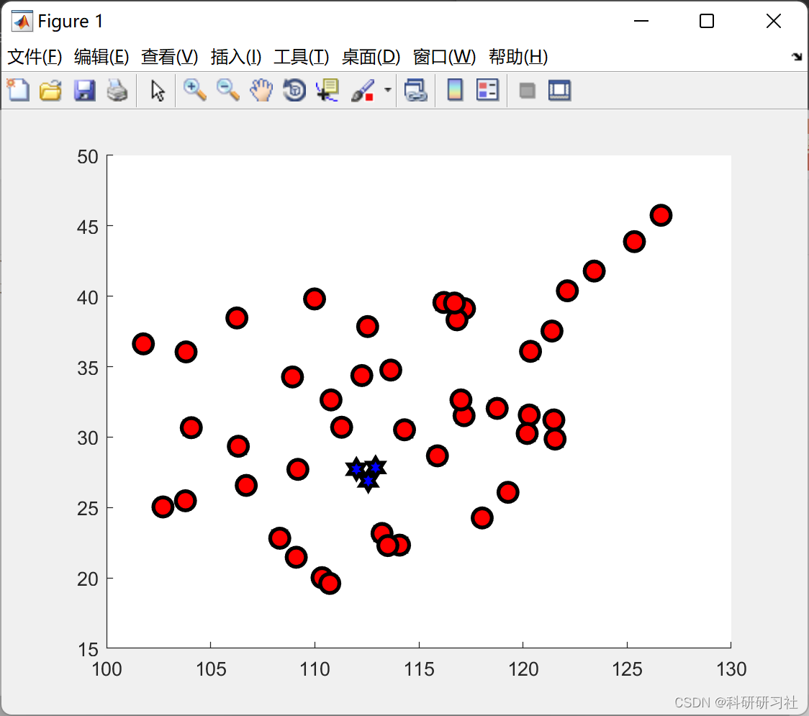
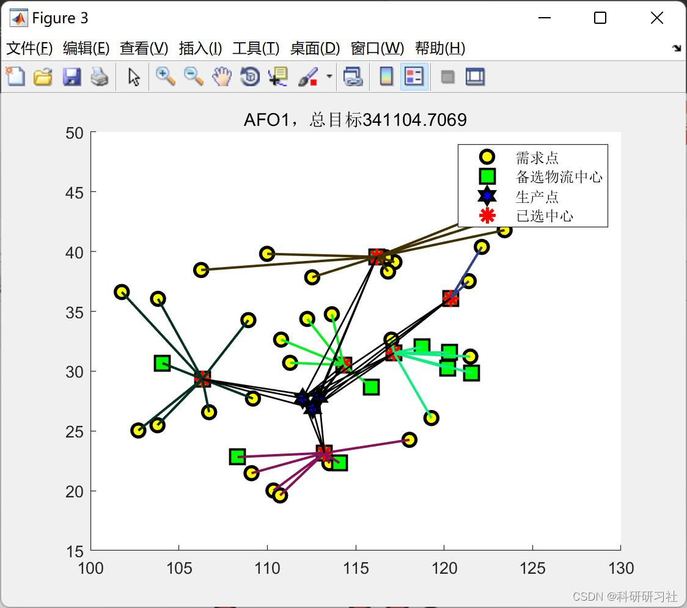
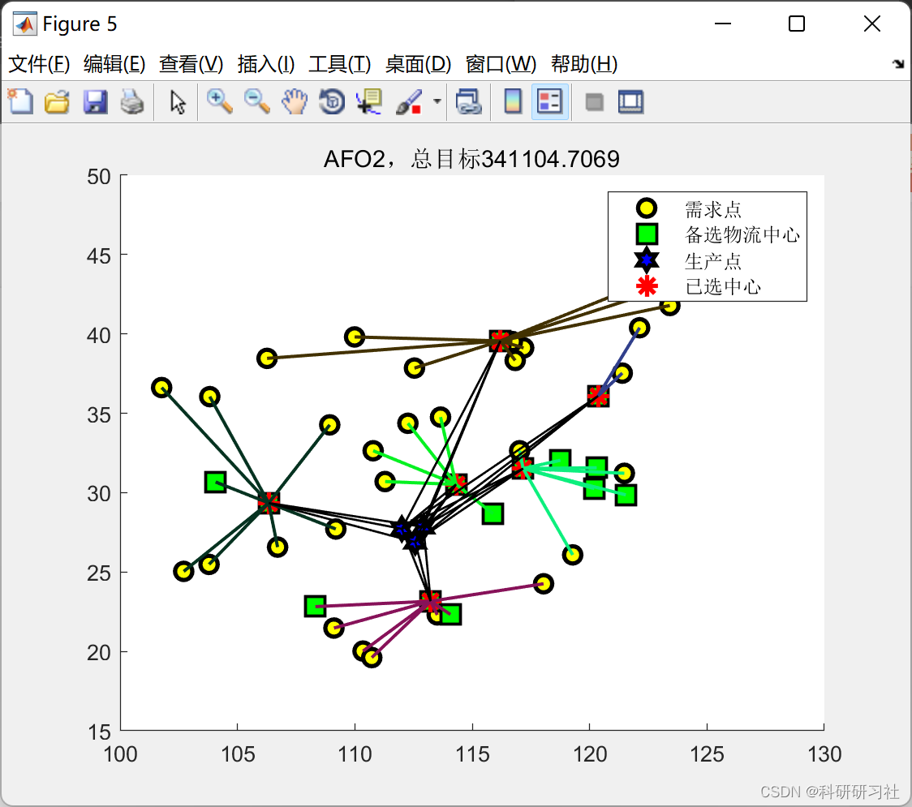
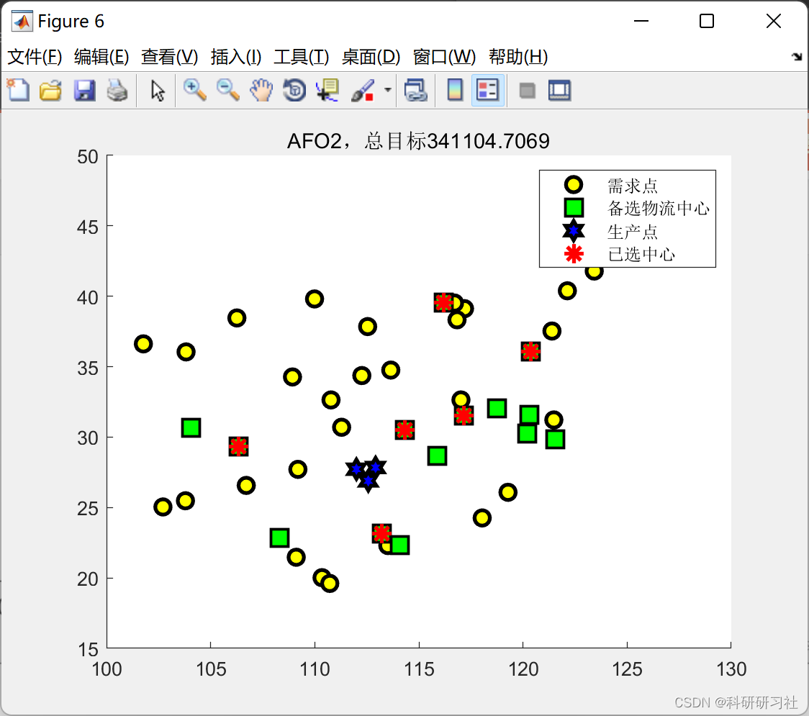

# [Logistics Center Location]Application of Intelligent Optimization Algorithm in Logistics Center Location (Matlab Code Realization)

The intelligent algorithm is: Emperor Penguin Optimization Algorithm.
1. Overview in the context of the new era. The logistics industry increasingly highlights its indispensable strategic position in the process of social and economic development. [1-31] In the entire operation process of the logistics network, The logistics center serves as a communication bridge between the supply and demand points. In logistics system
It plays an extremely important role. Therefore, selecting an appropriate logistics center will have a significant impact on the improvement of logistics economic benefits. The logistics industry in our country has a relatively late start. The logistics system faces numerous issues such as structural inadequacy and limited corporate experience. Particularly, there are many drawbacks in the selection of logistics center locations. For this purpose, Numerous scholars have conducted relevant explorations and studies on it.
The location of the logistics center plays a very important role throughout the entire logistics system. Due to the fact that the logistics site selection often involves linear issues.
And nonlinear factors, Traditional methods of logistics center site selection often fail to address nonlinear factors. Therefore, some influencing factors will be ignored. For this purpose, Research on the application of Penguin Intelligent Optimization Algorithm in Logistics Center Site Selection.
2. The Matlab code implementation of this article is only a part of the code, and all the code can be found by clicking the link:
[Logistics Center Site Selection]Application of Intelligent Optimization Algorithm in Logistics Center Site Selection (Matlab Code Realization)
function [fit,result,x0]=aimFcn_1(x,option,data)\nx0=x;\n%% Decoding\nx1=x(1:data.numD);\nx(1:data.numD)=[];\n[~,S]=sort(x);\nselectedC=S(1:data.numSelected);\nif isempty(selectedC)\n    selectedC=1;\nend\nselectedC0=data.noC(selectedC);\n%% Arrange the delivery path for nodes\n[~,S]=sort(x1);\nLoad=selectedC*0+data.maxLoad;\nflagC=selectedC*0;\nrecording=[];\ndemand=data.demand(:,1:data.numP);\ndemandC=zeros(length(selectedC),3);\nfor i=1:data.numD\n    noD=data.noD(S(i));\n    noD0=S(i);  \n    for noP=1:data.numP\n        if demand(noD0,noP)>0\n            position=find(Load>demand(noD0,noP));\n            if ~isempty(position)\n                [D1,no]=min(data.D1(noD,selectedC(position)));\n                Load(position(no))=Load(position(no))-demand(noD0,noP);\n                noC=selectedC(position(no));\n                noC0=selectedC0(position(no));\n                noP0=data.noP(noP);\n                D2=data.D2(noC,noP)/1000;\n                demandC(position(no),noP)=demandC(position(no),noP)+demand(noD0,noP);\n                recording=[recording;noP,noC,noD0,noP0,noC0,noD,demand(noD0,noP),D1,D2];\n                % 1 Production Site Independent Number 2 Logistics Center Independent Number 3 Demand Place Independent Number\n                % 4 Production location unified numbering 5 Logistics center unified numbering 6 Demand location unified numbering\n                % 7 Requirements 8 Distance from demand location to logistics center 9 Distance from logistics center to production location\n                demand(noD0,noP)=0;\n            end\n        end\n    end\nend\n%% Fixed Costs\nC1=sum(data.node(selectedC0,4));\n%% Transportation Costs\nC21=data.ct2*sum(recording(:,7).*(recording(:,8)));\nC22=data.ct1*sum(recording(:,7).*(recording(:,9)));\n%% Variable cost\nC3=sum(sum(data.demand.^data.alpha))*data.cb;\n%% Inventory Cost\nC4=sum(sum(data.demand))*data.ck/12;\n%% Penalty Item - Whether all requirements are met\npunishiment=sum(sum(demand(demand>0)));\nfit=C1+C21+C22+C3+C4+punishiment*1e6;\nif nargout>1\n    result.fit=fit; %Total Objective\n    result.recording=recording; %Detailed Recording\n    % 1 Production Site Independent Number 2 Logistics Center Independent Number 3 Demand Place Independent Number\n    % 4 Production location unified number 5 Logistics center unified number 6 Demand location unified number\n    % 7 Requirements 8 Distance from demand location to logistics center 9 Distance from logistics center to production location\n    result.selectedC0=selectedC0; %2 Logistics Center Independent Number\n    result.selectedC=selectedC;   %5 Unified Serial Number of Logistics Center\n    result.C1=C1;\n    result.C21=C21;\n    result.C22=C22;\n    result.C3=C3;\n    result.C4=C4;\n    result.demandC=demandC; % Each load in transit\n    result.punishiment=punishiment; % How many needs are not met\nend\nend\n  
3. Running Results Editing
Editor
Editor
Editor
Editor
4. References [1] Shu Xuzhen. Analysis of Logistics Center Site-Selection Problem Based on Fuzzy Comprehensive Evaluation Method [J]. Neijiang Science and Technology, 2021, 42(3): 43-44
[2] Wang Baohua, He Shiwei. Robust Optimization Model and Its Algorithm for Logistics Center Site Selection in Uncertain Environment [J]. Transportation Systems Engineering and Information, 2009, 9(2): 69-74
[3] Xuan Wenyi, Wang Bo, Yuan Jianqiang. A Location-Selection Method for Third-Party Logistics Enterprise Logistics Center Based on Genetic Algorithm and Indicator Satisfaction Solving [J]. Journal of Operations and Management, 2004, 13(2): 139-144
​  

## Images

<!-- PAYMENT_BLOCK -->

## Get this dataset

- Payment link (Stripe): [Buy now](https://buy.stripe.com/3cs8yP7sY87d0vu9AB)
- Payment QR code: 

<!-- /PAYMENT_BLOCK -->
